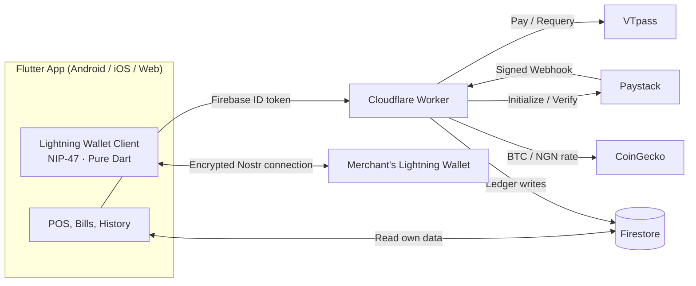

# Oja POS

**A modern point-of-sale platform built for market traders and POS agents in Nigeria.**

Oja POS brings payments, utility sales, and business tracking into one application. Built with Flutter, it supports Android, iOS, and web from a single codebase.

### What it does

- **Accept payments:** Receive Bitcoin over the Lightning Network, card payments, bank transfers, and USSD through Paystack, or record cash sales.
- **Sell digital services:** Offer airtime, mobile data, television subscriptions, and electricity tokens through VTpass.
- **Manage business finances:** Track daily sales, naira float, Lightning payments, and transaction history.
- **Operate across platforms:** Access your POS from Android, iOS, or a web browser.

Built for the **Dakar Bitcoin Hack 2026**.

---

## Architecture

Oja POS uses Flutter for the client application, Firebase for authentication and data storage, and Cloudflare Workers for secure backend operations.



### Payment flows

**1. Bitcoin Lightning**

Merchants connect their own Lightning wallet by pasting a Nostr Wallet Connect (NWC) connection string.

The app requests an invoice from the connected wallet, displays it as a QR code, and monitors payment status. Once paid, the sats go directly to the merchant's wallet.

Oja POS does not custody or hold Bitcoin.

The NWC connection string is stored using device secure storage. The Lightning client is implemented in pure Dart and supports:

- BIP-340 Schnorr signatures.
- NIP-44 v2 encryption.
- NIP-04 encryption fallback.
- NIP-47 wallet requests and responses.

**2. Paystack payments**

The backend initializes transactions through Paystack. The app displays the checkout link as a QR code for the customer.

After payment, the Worker verifies the transaction with Paystack and credits the merchant's naira float. A signed webhook provides an additional payment confirmation mechanism when the app is closed.

**3. Bills and utility payments**

The Worker validates bill requests, deducts the required amount from the merchant's float, and creates a pending transaction before calling VTpass.

Transactions are settled according to the provider's response:

- Successful purchases are recorded.
- Definite failures are refunded.
- Ambiguous outcomes remain pending until a status check resolves them.

---

## Security architecture

Security is enforced at the backend and database levels.

- **Protected credentials:** Paystack, VTpass, and Firebase Admin credentials are stored as Cloudflare Worker secrets, never embedded in the client application.
- **Authentication:** Protected Worker endpoints require verified Firebase ID tokens.
- **Balance protection:** The client cannot directly modify its own float balance.
- **Firestore security rules:** Clients are restricted to permitted data operations, including recording cash and Lightning sales.
- **Server-side ledger:** The Worker controls float updates and Paystack and bill transaction records.
- **Idempotent credits:** Payment references prevent duplicate credits from webhook and manual verification requests.
- **Concurrency protection:** Debits use optimistic concurrency controls to prevent simultaneous purchases from overdrawing the float.
- **Server-side pricing:** Data and television plan prices are retrieved and validated by the backend.
- **Webhook verification:** Paystack webhooks are validated using HMAC-SHA512 signatures, with payment amounts checked against backend records.
- **Safe bill settlement:** Network errors alone do not trigger refunds. Refunds are issued only for definite failures.

---

## Technology stack

| Layer | Technology |
|---|---|
| Mobile and web | Flutter, Dart |
| Authentication | Firebase Authentication |
| Database | Cloud Firestore |
| Backend API | Cloudflare Workers, TypeScript |
| Card and transfer payments | Paystack |
| Utility payments | VTpass |
| Bitcoin payments | Lightning Network, Nostr Wallet Connect |
| Exchange rates | CoinGecko |
| Deployment | Firebase Hosting, Cloudflare Workers |

---

## Project structure

```text
oja_pos/
├── lib/
│   ├── services/
│   │   ├── nwc.dart          # Lightning wallet client
│   │   ├── api.dart          # Cloudflare Worker API client
│   │   └── db.dart           # Firestore operations
│   ├── screens/
│   │   ├── auth_screen.dart
│   │   ├── home_screen.dart
│   │   ├── charge_screen.dart
│   │   ├── collect_screen.dart
│   │   ├── bills_screen.dart
│   │   ├── history_screen.dart
│   │   └── more_screen.dart
│   ├── widgets/
│   ├── models/
│   ├── config.dart
│   └── firebase_options.dart
├── worker/
│   ├── src/                  # Worker API implementation
│   ├── test/                 # Backend tests
│   └── wrangler.toml
├── test/                     # Flutter tests
├── assets/                   # Brand assets and illustrations
├── branding/                 # Platform icon assets
├── landing/
│   ├── index.html            # Website landing page
│   └── app/                  # Flutter web build
├── brand/                    # SVG brand sources
├── firestore.rules
├── firebase.json
├── setup.sh
└── build_web.sh
```

---

## Getting started

### Requirements

- Flutter SDK 3.22 or later.
- Dart SDK compatible with the Flutter installation.
- Node.js 20 or later.
- A Firebase project.
- A Cloudflare account.
- Paystack and VTpass accounts.

### 1. Clone the repository

```bash
git clone https://github.com/Gideonjon/oja_pos.git
cd oja_pos
```

### 2. Configure Firebase

Create a Firebase project and configure the following services:

1. Enable **Authentication → Sign-in method → Email/Password**.
2. Create a Cloud Firestore database.
3. Deploy the Firestore security rules:

```bash
firebase deploy --only firestore:rules
```

4. Register the Android, iOS, and web applications in Firebase.
5. Configure FlutterFire and generate `lib/firebase_options.dart`:

```bash
dart pub global activate flutterfire_cli

flutterfire configure --platforms=android,ios,web
```

For backend access, generate a Firebase service account key under **Project settings → Service accounts**. Keep the downloaded JSON private and out of version control.

### 3. Configure and deploy the backend

Navigate to the Worker directory:

```bash
cd worker

npm install
npm test
```

Configure `wrangler.toml` with your Firebase project ID and the required environment settings.

Authenticate with Cloudflare:

```bash
npx wrangler login
```

Add the backend credentials as Worker secrets:

```bash
npx wrangler secret put PAYSTACK_SECRET_KEY
npx wrangler secret put VTPASS_API_KEY
npx wrangler secret put VTPASS_PUBLIC_KEY
npx wrangler secret put VTPASS_SECRET_KEY
npx wrangler secret put FIREBASE_SERVICE_ACCOUNT
```

For `FIREBASE_SERVICE_ACCOUNT`, provide the complete service account JSON content when prompted.

Deploy:

```bash
npx wrangler deploy
```

Your Worker URL will look like:

```text
https://oja-pos-api.<your-subdomain>.workers.dev
```

Verify the deployment:

```bash
curl https://oja-pos-api.<your-subdomain>.workers.dev/health
```

Expected response:

```json
{
  "ok": true,
  "service": "oja-pos-api"
}
```

### 4. Configure Paystack webhooks

In the Paystack Dashboard, navigate to:

**Settings → API Keys & Webhooks**

Set the webhook URL to:

```text
https://oja-pos-api.<your-subdomain>.workers.dev/paystack/webhook
```

Use test credentials while testing. Switch to live credentials only after completing the required integration checks.

### 5. Configure VTpass

The Worker is initially configured to use the VTpass sandbox.

The sandbox endpoint is:

```text
https://sandbox.vtpass.com/api
```

Configure the appropriate live endpoint and credentials when moving to production.

### 6. Run the Flutter application

Return to the repository root:

```bash
cd ..
```

Install dependencies:

```bash
flutter pub get
```

Run the application with your deployed Worker URL:

```bash
flutter run \
  --dart-define=API_BASE_URL=https://oja-pos-api.<your-subdomain>.workers.dev
```

To run the web version:

```bash
flutter run -d chrome \
  --dart-define=API_BASE_URL=https://oja-pos-api.<your-subdomain>.workers.dev
```

---

## Website deployment

The Oja POS website consists of two parts:

- A landing page at the root domain.
- The Flutter web application hosted under `/app/`.

The landing page's **Log in** and **Create account** buttons open the corresponding authentication screens:

```text
/app/?mode=login
/app/?mode=signup
```

The Flutter web application supports responsive layouts for desktop and mobile devices.

### Build the web application

From the repository root:

```bash
flutter build web --release \
  --base-href /app/ \
  --dart-define=API_BASE_URL=https://oja-pos-api.<your-subdomain>.workers.dev
```

Copy the build into the landing directory:

```bash
rm -rf landing/app
mkdir -p landing/app

cp -R build/web/. landing/app/
```

### Deploy with Firebase Hosting

Firebase Hosting serves the landing page and Flutter application from the `landing/` directory.

The Hosting configuration in `firebase.json` should include:

```json
{
  "hosting": {
    "public": "landing",
    "ignore": [
      "firebase.json",
      "**/.*",
      "**/node_modules/**"
    ],
    "rewrites": [
      {
        "source": "/app/**",
        "destination": "/app/index.html"
      }
    ]
  }
}
```

Preserve any existing Firestore and Flutter configuration in `firebase.json` when adding the Hosting configuration.

Deploy:

```bash
firebase deploy --only hosting
```

The default Firebase Hosting URL is:

```text
https://ojapos.web.app
```

Add your deployed website domain to **Firebase Authentication → Settings → Authorized domains**.

Configure the Worker CORS allowlist to permit requests from your deployed website origin.

### Android APK builds

Build a release APK:

```bash
flutter build apk --release \
  --dart-define=API_BASE_URL=https://oja-pos-api.<your-subdomain>.workers.dev
```

For smaller, architecture-specific APKs:

```bash
flutter build apk --release \
  --split-per-abi \
  --dart-define=API_BASE_URL=https://oja-pos-api.<your-subdomain>.workers.dev
```

Flutter generates:

```text
build/app/outputs/flutter-apk/
├── app-armeabi-v7a-release.apk
├── app-arm64-v8a-release.apk
└── app-x86_64-release.apk
```

**APK distribution:** Firebase Hosting on the Spark plan does not permit executable APK uploads. Host APK files separately using Cloudflare R2 or GitHub Releases, then point the Android download button on the landing page to the hosted APK URL.

The landing page's download targets are configured in the `LINKS` block near the bottom of `landing/index.html`.

Add your Android APK URL, iOS App Store or TestFlight URL, and repository URL as they become available.

---

## Branding

Oja POS uses a distinctive lowercase **oja** wordmark, with an orange lightning bolt as the dot above the letter `j`.

The brand assets include:

- `brand/logo-lockup.svg` — green wordmark.
- `brand/logo-lockup-light.svg` — white wordmark.
- `brand/logo-lockup-ink.svg` — dark wordmark.
- `brand/logo-mark.svg` — application icon.

The `branding/` directory contains platform-specific icon assets for Android, iOS, and web.

To update the brand, edit the SVG source files and regenerate the relevant platform assets.

---

## Demo walkthrough

A three-minute demonstration of the main product flows:

1. **Create an account:** Register a merchant account using a business name.
2. **Connect a Lightning wallet:** Navigate to Account → Connect wallet and paste an NWC connection string.
3. **Receive Bitcoin:** Navigate to Charge, enter ₦1,500, select Lightning, and pay the displayed QR code using another Lightning wallet.
4. **Accept a Paystack payment:** Navigate to Charge, enter ₦2,000, select Card / Transfer, and complete the payment using Paystack test credentials.
5. **Sell airtime:** Navigate to Bills, select Airtime, enter ₦500, choose MTN, and use the configured VTpass sandbox test number.

The dashboard and transaction history reflect the resulting activity.

---

## API reference

All endpoints except `/health`, `/rates`, and the Paystack webhook require:

```http
Authorization: Bearer <Firebase ID token>
```

| Method | Endpoint | Purpose |
|---|---|---|
| GET | `/health` | Worker health check |
| GET | `/rates` | BTC/NGN exchange rate |
| POST | `/paystack/initialize` | Initialize a payment |
| POST | `/paystack/verify` | Verify a payment and credit float |
| POST | `/paystack/webhook` | Process Paystack payment webhooks |
| GET | `/bills/variations?serviceID=` | Retrieve data and TV plans |
| POST | `/bills/verify-customer` | Verify meter or smartcard details |
| POST | `/bills/pay` | Purchase airtime, data, TV, or electricity |
| POST | `/bills/requery` | Resolve pending bill transactions |

---

## Known limitations

- **Float withdrawals:** Paystack sales are credited to the in-app naira float and can be used for bill payments. Withdrawal of the float to a bank account through Paystack Transfers is not yet implemented.
- **Paystack fees:** Transaction fees are not currently deducted from the credited amount.
- **Lightning relay authentication:** NIP-42 authentication is not implemented. Wallets requiring authenticated relay connections may not work.
- **VTpass IP whitelisting:** Cloudflare Workers do not provide a fixed outbound IP by default. Live VTpass accounts enforcing IP whitelisting may require an alternative network arrangement.
- **Rate limiting:** Worker-level rate limiting needs to be configured before production use.
- **Amount precision:** Naira amounts are represented as whole naira. Lightning amounts are rounded up to the next satoshi.

---

## Troubleshooting

| Issue | Suggested resolution |
|---|---|
| Firebase is not configured | Run `flutterfire configure` from the repository root. |
| Android build fails because of minSdk | Set the Android minimum SDK to 23 or higher. |
| Cannot reach the server | Verify the `API_BASE_URL` passed through `--dart-define`. |
| Session expires on every API call | Check that the Worker Firebase project ID matches the application's Firebase project. |
| Web authentication fails after deployment | Add the website domain to Firebase Authentication's authorized domains. |
| Firebase Hosting rejects an APK | Host the APK separately using R2 or GitHub Releases. |

---

## License

MIT License.
